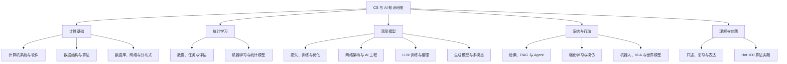

<!-- Generated from data/knowledge-map.mjs and canonical content. -->

# CS 与 AI 知识地图

将 106 讲整理为 **14 个领域、147 个概念词条组、100 道练习与 4 条专题路线**。概念关系经过编辑组织，目录归属与推荐学习次序单独标注。

[交互知识图](knowledge-map.html) · [Obsidian 笔记库首页](../obsidian-vault/00-知识地图.md) · [下载整套资料](https://github.com/DengZhiyuan-math/dictionary-of-computer-science-and-AI/releases/latest)

下载并解压后，用 Obsidian“打开文件夹为仓库”选择 `obsidian-vault`，从 `00-知识地图.md` 开始。笔记库内使用真实双链、别名与章节标题链接，不依赖社区插件；GitHub 阅读请用本页的普通 Markdown 链接。

## 整体结构

## 领域入口与关键问题

| 领域 | 核心问题 | 阅读原文 |
| --- | --- | --- |
| [计算机系统与软件](#area-systems) | 程序如何在硬件与操作系统上运行？ | [02](../chapters/02.md)、[03](../chapters/03.md)、[04](../chapters/04.md) |
| [数据结构与算法](#area-algorithms) | 怎样组织数据并减少计算与存储成本？ | [05](../chapters/05.md)、[06](../chapters/06.md)、[07](../chapters/07.md)、[08](../chapters/08.md)、[09](../chapters/09.md)、[10](../chapters/10.md)、[11](../chapters/11.md)、[12](../chapters/12.md)、[13](../chapters/13.md)、[98](../chapters/98.md)、[99](../chapters/99.md)、[100](../chapters/100.md)、[101](../chapters/101.md)、[102](../chapters/102.md)、[103](../chapters/103.md)、[104](../chapters/104.md)、[105](../chapters/105.md) |
| [数据库、网络与分布式](#area-infrastructure) | 怎样可靠地存储、传输和协同处理数据？ | [14](../chapters/14.md)、[15](../chapters/15.md)、[16](../chapters/16.md)、[17](../chapters/17.md)、[18](../chapters/18.md)、[19](../chapters/19.md)、[20](../chapters/20.md) |
| [数据、任务与评估](#area-data-evaluation) | 输入和目标是什么，怎样判断模型对新数据有效？ | [21](../chapters/21.md)、[22](../chapters/22.md)、[23](../chapters/23.md)、[24](../chapters/24.md)、[37](../chapters/37.md)、[38](../chapters/38.md)、[39](../chapters/39.md) |
| [机器学习与统计模型](#area-ml-methods) | 不同数据结构和目标适合哪些模型假设？ | [25](../chapters/25.md)、[26](../chapters/26.md)、[27](../chapters/27.md)、[28](../chapters/28.md)、[29](../chapters/29.md)、[30](../chapters/30.md)、[31](../chapters/31.md)、[32](../chapters/32.md)、[33](../chapters/33.md)、[34](../chapters/34.md)、[35](../chapters/35.md)、[36](../chapters/36.md) |
| [损失、训练与优化](#area-training) | 模型误差怎样变成参数更新，怎样让过程稳定？ | [40](../chapters/40.md)、[41](../chapters/41.md)、[42](../chapters/42.md)、[43](../chapters/43.md)、[44](../chapters/44.md)、[45](../chapters/45.md)、[46](../chapters/46.md)、[47](../chapters/47.md) |
| [网络架构与 AI 工程](#area-architectures) | 不同结构怎样表达数据，又怎样部署成可维护系统？ | [48](../chapters/48.md)、[49](../chapters/49.md)、[50](../chapters/50.md)、[51](../chapters/51.md) |
| [LLM 训练与推理](#area-llm) | 语言模型怎样表示、训练、对齐并高效生成？ | [52](../chapters/52.md)、[53](../chapters/53.md)、[54](../chapters/54.md)、[55](../chapters/55.md)、[56](../chapters/56.md)、[57](../chapters/57.md)、[58](../chapters/58.md) |
| [检索、RAG 与 Agent](#area-retrieval-agents) | 怎样把模型与外部知识、状态和工具执行连接起来？ | [59](../chapters/59.md)、[60](../chapters/60.md)、[61](../chapters/61.md) |
| [生成模型与多模态](#area-multimodal) | 怎样学习分布与跨模态表示，生成图像、声音或视频？ | [62](../chapters/62.md)、[63](../chapters/63.md)、[64](../chapters/64.md) |
| [强化学习与模仿](#area-rl) | 怎样根据奖励、经验或示范学习长期决策？ | [65](../chapters/65.md)、[66](../chapters/66.md)、[67](../chapters/67.md)、[68](../chapters/68.md) |
| [机器人、VLA 与世界模型](#area-embodied) | 怎样从观察与语言走向可反馈的行动与预测？ | [69](../chapters/69.md)、[70](../chapters/70.md)、[71](../chapters/71.md)、[72](../chapters/72.md)、[73](../chapters/73.md) |
| [口述、复习与表达](#area-practice) | 能否用自己的话解释机制、举例并说出局限？ | [01](../chapters/01.md)、[74](../chapters/74.md)、[75](../chapters/75.md)、[76](../chapters/76.md)、[77](../chapters/77.md)、[78](../chapters/78.md)、[79](../chapters/79.md)、[80](../chapters/80.md)、[106](../chapters/106.md) |
| [Hot 100 算法实践](#area-hot100) | 怎样从题目约束推导状态、不变式和正确性？ | [81](../chapters/81.md)、[82](../chapters/82.md)、[83](../chapters/83.md)、[84](../chapters/84.md)、[85](../chapters/85.md)、[86](../chapters/86.md)、[87](../chapters/87.md)、[88](../chapters/88.md)、[89](../chapters/89.md)、[90](../chapters/90.md)、[91](../chapters/91.md)、[92](../chapters/92.md)、[93](../chapters/93.md)、[94](../chapters/94.md)、[95](../chapters/95.md)、[96](../chapters/96.md)、[97](../chapters/97.md) |

## 怎样读关系

| 关系 | 意义 |
| --- | --- |
| 先修 | 推荐先理解的概念，用于解释后续概念 |
| 用于 | 一种结构或方法帮助实现另一任务 |
| 关联 | 有共同机制或跨领域连接，需要阅读边上的解释 |
| 对照 | 容易混淆而需要区分的目标、结构或机制 |
| 章节解释／练习 | 概念的阅读依据或实践入口 |

## 四条专题地图

### 训练流程地图

沿一次参数更新连接输入、损失、梯度与评价。

[样本／特征／标签](../chapters/22.md) → [张量／形状／轴](../chapters/22.md) → [二分类／互斥多分类／多标签](../chapters/22.md) → [概率变换前的分数](../chapters/22.md) → [融合 Sigmoid 的二元交叉熵](../chapters/41.md) → [前向／反向传播](../chapters/44.md) → [梯度](../chapters/44.md) → [学习率](../chapters/43.md) → [自适应矩估计／解耦权重衰减](../chapters/45.md) → [学习率调度器](../chapters/43.md) → [精确率](../chapters/38.md) → [概率校准](../chapters/38.md)

### 算法思想地图

从操作成本与不变式，走到状态设计和题目练习。

[复杂度与资源成本](../chapters/07.md) → [数组、链表、树与图](../chapters/05.md) → [哈希表](../chapters/05.md) → [循环不变式](../chapters/82.md) → [双指针](../chapters/82.md) → [滑动窗口](../chapters/83.md) → [前缀和](../chapters/84.md) → [单调栈](../chapters/92.md) → [单调双端队列](../chapters/84.md) → [动态规划](../chapters/09.md) → [回溯／剪枝](../chapters/90.md) → [首次不小于／首次大于的边界](../chapters/91.md) → [并查集](../chapters/98.md) → [零一最短路](../chapters/99.md) → [树状数组](../chapters/100.md) → [线段树与懒标记](../chapters/100.md) → [KMP 与前缀函数](../chapters/101.md) → [多模式自动机](../chapters/101.md) → [最长递增子序列与结尾状态](../chapters/102.md) → [带权区间调度](../chapters/102.md) → [区间动态规划](../chapters/102.md) → [状态压缩动态规划](../chapters/102.md) → [二分答案与可行性](../chapters/103.md) → [蓄水池采样](../chapters/104.md) → [布隆过滤器](../chapters/104.md) → [摊还分析](../chapters/105.md)

### LLM 系统地图

区分模型内部训练推理、外部检索与工具执行。

[张量／形状／轴](../chapters/22.md) → [词元／向量表示](../chapters/52.md) → [注意力／Transformer 架构](../chapters/53.md) → [交叉熵／负对数似然](../chapters/41.md) → [监督微调／低秩适配／量化低秩适配](../chapters/55.md) → [直接偏好优化／组相对策略优化](../chapters/56.md) → [键值缓存／高效注意力计算](../chapters/58.md) → [词项检索评分／近似近邻图索引](../chapters/60.md) → [检索增强生成](../chapters/59.md) → [智能体](../chapters/61.md) → [部署、监控与 MLOps](../chapters/51.md)

### 行动与世界模型地图

把表征、示范、奖励、控制和预测放在同一行动链里比较。

[多模态对齐与表征](../chapters/64.md) → [模仿学习与示范数据](../chapters/68.md) → [回报、价值与 Bellman 关系](../chapters/65.md) → [策略梯度与 Actor-Critic](../chapters/65.md) → [策略与价值学习方法](../chapters/67.md) → [定位、规划与控制](../chapters/70.md) → [反馈控制／模型预测控制](../chapters/70.md) → [视觉语言动作模型](../chapters/69.md) → [世界模型](../chapters/72.md) → [想象中学习策略／学模型并搜索](../chapters/73.md)

## 领域中的概念与连接

### 计算机系统与软件

把 CPU、GPU、内存、进程、并发和软件接口接起来，理解计算资源与抽象边界。

GPU 的并行计算会影响张量计算、混合精度和训练吞吐。

| 概念 | 核心含义 | 阅读依据 |
| --- | --- | --- |
| 应用程序编程接口（API） | 软件向其他程序暴露的调用约定，包括输入、输出和错误行为。 | [第 04 讲](../chapters/04.md) |
| 并发／并行（Concurrency / Parallelism） | 并发让多项工作交替推进；并行让多项工作在同一时间执行。 | [第 02 讲](../chapters/02.md) |
| 中央处理器／图形处理器（CPU / GPU） | CPU 擅长复杂控制流程；GPU 擅长适合并行的大量相似计算。 | [第 02 讲](../chapters/02.md) |
| 操作系统与资源管理（Operating System） | 管理程序执行、内存、调度与同步，让有限资源服务多个任务。 | [第 02 讲](../chapters/02.md)、[第 03 讲](../chapters/03.md) |

- **有解释的关联**：[操作系统与资源管理](../chapters/02.md) → [并发／并行](../chapters/02.md)：调度与资源决定执行方式。
- **用于或帮助实现**：[中央处理器／图形处理器](../chapters/02.md) → [数据类型／计算设备](../chapters/22.md)：计算硬件承载张量与数值表示。
- **需要区分**：[并发／并行](../chapters/02.md) → [复制／分片](../chapters/19.md)：执行并行与数据分布是不同层次。

### 数据结构与算法

从数据结构、复杂度与算法设计思想，走到树、图、字符串、搜索和优化。

树与哈希既是刷题结构，也进入数据库索引、缓存和近邻检索。

| 概念 | 核心含义 | 阅读依据 |
| --- | --- | --- |
| 广度／深度优先搜索（BFS / DFS） | BFS 逐层扩展，DFS 沿路径深入后回退。 | [第 10 讲](../chapters/10.md) |
| 非负权最短路算法（Dijkstra） | 反复确定当前最近节点，并用它松弛其他路径。 | [第 10 讲](../chapters/10.md) |
| 动态规划（Dynamic Programming） | 保存可复用的子问题结果，按状态与转移关系求解。 | [第 09 讲](../chapters/09.md) |
| 哈希表（Hash Table） | 把键映射到存储位置，以支持高效的按键查找。 | [第 05 讲](../chapters/05.md) |
| 贪心与安全选择（Greedy） | 通过可证明安全的当前选择或边界扩展，逐步构造满足目标的解。 | [第 07 讲](../chapters/07.md)、[第 94 讲](../chapters/94.md) |
| 复杂度与资源成本（Complexity） | 把时间、辅助空间与输出成本分开分析，并说明期望、摊还和最坏情况的差别。 | [第 07 讲](../chapters/07.md)、[第 08 讲](../chapters/08.md)、[第 13 讲](../chapters/13.md) |
| 递归与子问题契约（Recursion） | 定义一个调用解决什么子问题、返回什么结果，以及何时终止，再组织子调用。 | [第 09 讲](../chapters/09.md)、[第 88 讲](../chapters/88.md)、[第 90 讲](../chapters/90.md) |
| 数组、链表、树与图（Data Structures） | 根据主要操作选择信息的组织方式，理解访问、更新、顺序与连接关系的成本。 | [第 05 讲](../chapters/05.md)、[第 06 讲](../chapters/06.md)、[第 87 讲](../chapters/87.md) |
| 图、路径与依赖（Graph Algorithms） | 把连接、可达、最短路与先后依赖转成节点、边及相应遍历或优化问题。 | [第 10 讲](../chapters/10.md)、[第 11 讲](../chapters/11.md)、[第 89 讲](../chapters/89.md) |
| 并查集（Disjoint Set Union） | 用代表元维护互不重叠集合，支持连通判断与合并。 | [第 98 讲](../chapters/98.md) |
| 零一最短路（0-1 BFS） | 用双端队列处理边权只有 0 与 1 的最短路。 | [第 99 讲](../chapters/99.md) |
| Bellman-Ford 与负环（Bellman-Ford） | 重复松弛处理负边，并区分源点可达负环的影响。 | [第 99 讲](../chapters/99.md) |
| 树状数组（Fenwick Tree） | 以二进制分块支持单点加与前缀求和。 | [第 100 讲](../chapters/100.md) |
| 线段树与懒标记（Segment Tree） | 分层维护可合并的区间摘要，并按需传播区间更新。 | [第 100 讲](../chapters/100.md) |
| 差分数组（Difference Array） | 用区间端点变化压缩批量区间加，最后以前缀累加还原。 | [第 100 讲](../chapters/100.md) |
| KMP 与前缀函数（KMP Prefix Function） | 利用已匹配部分的真前后缀在失配后复用比较信息。 | [第 101 讲](../chapters/101.md) |
| 多模式自动机（Aho-Corasick） | 在前缀树上使用失败链接与输出关系寻找多个模式。 | [第 101 讲](../chapters/101.md) |
| 最长递增子序列与结尾状态（LIS Tails） | 保存每种长度的最小结尾，以二分更新最长严格递增长度。 | [第 102 讲](../chapters/102.md) |
| 带权区间调度（Weighted Interval Scheduling） | 按结束时间组织任务，把选择接到兼容前驱的最优收益。 | [第 102 讲](../chapters/102.md) |
| 区间动态规划（Interval DP） | 用连续区间定义子问题，枚举切分并按长度填表。 | [第 102 讲](../chapters/102.md) |
| 状态压缩动态规划（Bitmask DP） | 把小规模集合编码进状态，显式保留访问集合与终点。 | [第 102 讲](../chapters/102.md) |
| 二分答案与可行性（Binary Search on Answer） | 利用候选答案下的单调可行性查找最优边界。 | [第 103 讲](../chapters/103.md) |
| 蓄水池采样（Reservoir Sampling） | 在未知长度的数据流中使用固定空间进行均匀采样。 | [第 104 讲](../chapters/104.md) |
| 布隆过滤器（Bloom Filter） | 用位数组与多个哈希位置做允许假阳性的成员过滤。 | [第 104 讲](../chapters/104.md) |
| 摊还分析（Amortized Analysis） | 通过一串操作的总代价说明每次操作的平均分摊成本。 | [第 105 讲](../chapters/105.md) |

- **有解释的关联**：[复杂度与资源成本](../chapters/07.md) → [数组、链表、树与图](../chapters/05.md)：数据结构决定基本操作成本。
- **推荐的理解先修**：[数组、链表、树与图](../chapters/05.md) → [哈希表](../chapters/05.md)：先理解按键组织与查询。
- **推荐的理解先修**：[数组、链表、树与图](../chapters/05.md) → [图、路径与依赖](../chapters/10.md)：先理解节点与边。
- **推荐的理解先修**：[递归与子问题契约](../chapters/09.md) → [树上的后序动态规划](../chapters/88.md)：先明确子调用返回契约。
- **推荐的理解先修**：[递归与子问题契约](../chapters/09.md) → [回溯／剪枝](../chapters/90.md)：回溯组织选择与撤销。
- **用于或帮助实现**：[哈希表](../chapters/05.md) → [前缀和](../chapters/84.md)：存储前缀频次以统计区间。
- **有解释的关联**：[哈希表](../chapters/05.md) → [规范化键](../chapters/81.md)：按等价类建立可查询键。
- **推荐的理解先修**：[动态规划](../chapters/09.md) → [零一背包／完全背包](../chapters/95.md)：用状态与依赖理解容量顺序。
- **用于或帮助实现**：[动态规划](../chapters/09.md) → [最大连续子数组和的线性状态更新](../chapters/85.md)：定义以当前位置结尾的最优和。
- **推荐的理解先修**：[图、路径与依赖](../chapters/10.md) → [广度／深度优先搜索](../chapters/10.md)：先定义图的邻接与访问状态。
- **推荐的理解先修**：[广度／深度优先搜索](../chapters/10.md) → [多源广度优先搜索](../chapters/89.md)：扩展为多个零距离起点。
- **用于或帮助实现**：[图、路径与依赖](../chapters/10.md) → [拓扑排序](../chapters/89.md)：有向依赖用入度组织推进。
- **有解释的关联**：[哈希表](../chapters/05.md) → [数据库索引](../chapters/15.md)：都是加速查找，结构与查询语义不同。
- **用于或帮助实现**：[哈希表](../chapters/05.md) → [缓存与复用](../chapters/18.md)：按键定位缓存条目。
- **推荐的理解先修**：[图、路径与依赖](../chapters/10.md) → [并查集](../chapters/98.md)：先区分连通问题与路径长度。
- **推荐的理解先修**：[图、路径与依赖](../chapters/10.md) → [零一最短路](../chapters/99.md)：边权集合决定队列规则。
- **需要区分**：[非负权最短路算法](../chapters/10.md) → [Bellman-Ford 与负环](../chapters/99.md)：非负权的确认规则与允许负边的重复松弛不同。
- **需要区分**：[广度／深度优先搜索](../chapters/10.md) → [零一最短路](../chapters/99.md)：等权首次发现规则不能直接搬到零一权图。
- **需要区分**：[树状数组](../chapters/100.md) → [线段树与懒标记](../chapters/100.md)：前缀消去与一般区间摘要的适用运算不同。
- **有解释的关联**：[KMP 与前缀函数](../chapters/101.md) → [多模式自动机](../chapters/101.md)：失配后复用后缀信息的思想跨越单模式与多模式。
- **推荐的理解先修**：[动态规划](../chapters/09.md) → [最长递增子序列与结尾状态](../chapters/102.md)：先解释二次 DP，再解释更小结尾的支配关系。
- **推荐的理解先修**：[动态规划](../chapters/09.md) → [带权区间调度](../chapters/102.md)：用兼容前驱组织带收益选择。
- **推荐的理解先修**：[动态规划](../chapters/09.md) → [区间动态规划](../chapters/102.md)：从子问题契约定义区间与最后划分。
- **推荐的理解先修**：[动态规划](../chapters/09.md) → [状态压缩动态规划](../chapters/102.md)：把访问集合加入状态含义。
- **需要区分**：[贪心与安全选择](../chapters/07.md) → [带权区间调度](../chapters/102.md)：最多任务数与最大收益需要不同论证。
- **推荐的理解先修**：[复杂度与资源成本](../chapters/07.md) → [摊还分析](../chapters/105.md)：先区分单次成本与一串操作总成本。
- **用于或帮助实现**：[布隆过滤器](../chapters/104.md) → [缓存与复用](../chapters/18.md)：可在精确查询前过滤肯定未插入的键。
- **有解释的关联**：[蓄水池采样](../chapters/104.md) → [复杂度与资源成本](../chapters/07.md)：固定空间采样以概率性质换取无需保存全流。

### 数据库、网络与分布式

区分索引与事务、传输与服务、复制与分片，以及多节点一致性与工程约束。

缓存、索引和分布式协调影响 AI 服务的延迟、吞吐与可靠性。

| 概念 | 核心含义 | 阅读依据 |
| --- | --- | --- |
| 数据库索引（Index） | 维护额外查找结构以减少查询需要扫描的数据。 | [第 15 讲](../chapters/15.md) |
| 复制／分片（Replication / Sharding） | 复制保留数据副本，分片把数据分到不同节点。 | [第 19 讲](../chapters/19.md) |
| 事务及其性质（Transaction / ACID） | 把一组操作作为逻辑单元，讨论原子性、一致性、隔离性和持久性。 | [第 14 讲](../chapters/14.md) |
| 网络与服务性能（Network） | 沿请求路径理解命名、传输、协议、拥塞、缓存和负载分配。 | [第 17 讲](../chapters/17.md)、[第 18 讲](../chapters/18.md) |
| 分布式共识（Consensus） | 在故障与通信约束下，让多个节点对日志或状态推进形成一致决定。 | [第 19 讲](../chapters/19.md)、[第 20 讲](../chapters/20.md) |
| 缓存与复用（Cache） | 保存可复用结果以减少重复工作，并管理容量、有效性与替换策略。 | [第 18 讲](../chapters/18.md)、[第 58 讲](../chapters/58.md)、[第 87 讲](../chapters/87.md) |

- **有解释的关联**：[数据库索引](../chapters/15.md) → [词项检索评分／近似近邻图索引](../chapters/60.md)：传统与检索系统都需要定位候选。
- **有解释的关联**：[复制／分片](../chapters/19.md) → [分布式共识](../chapters/19.md)：副本协同需要明确一致性与故障模型。
- **需要区分**：[事务及其性质](../chapters/14.md) → [分布式共识](../chapters/19.md)：事务性质与多节点达成决定不同。
- **用于或帮助实现**：[网络与服务性能](../chapters/17.md) → [智能体](../chapters/61.md)：工具执行需要处理外部服务与失败。
- **有解释的关联**：[缓存与复用](../chapters/18.md) → [键值缓存／高效注意力计算](../chapters/58.md)：复用模型前缀是缓存的一种专门场景。

### 数据、任务与评估

建立样本、标签、预测任务、数据划分、评价指标和因果边界，是模型比较与实验的共同基础。

数据泄露与概率校准会跨越传统 ML、深度学习与 LLM 评估。

| 概念 | 核心含义 | 阅读依据 |
| --- | --- | --- |
| 二分类／互斥多分类／多标签（Binary / Multiclass / Multilabel） | 分别对应是非判断、多个互斥答案中选一个、多个答案可以同时成立。 | [第 22 讲](../chapters/22.md) |
| 广播（Broadcasting） | 按形状规则扩展较小张量的运算含义，避免手动复制。 | [第 22 讲](../chapters/22.md) |
| 概率校准（Calibration） | 检查报出的概率与长期实际发生比例是否相符。 | [第 38 讲](../chapters/38.md) |
| 交叉验证（Cross-Validation） | 用多次数据划分评价训练流程，必要时以嵌套方式隔离模型选择。 | [第 38 讲](../chapters/38.md) |
| 数据泄露（Data Leakage） | 训练或选择模型时无意利用了实际预测拿不到的信息。 | [第 23 讲](../chapters/23.md) |
| 数据类型／计算设备（Dtype / Device） | Dtype 指数值表示方式，Device 指数据与运算所在的 CPU 或 GPU 等设备。 | [第 22 讲](../chapters/22.md) |
| 精确率与召回率的调和平均（F1） | 用一个数汇总 Precision 与 Recall，偏低的一项会限制结果。 | [第 38 讲](../chapters/38.md) |
| 概率变换前的分数（Logit） | 神经网络分类语境中，通常是尚未经过 Sigmoid 或 Softmax 的原始分数。 | [第 22 讲](../chapters/22.md) |
| 按类平均／汇总计数（Macro / Micro） | Macro 先算各类再等权平均；Micro 汇总计数后计算。 | [第 38 讲](../chapters/38.md) |
| 参数／超参数（Parameter / Hyperparameter） | 参数由拟合获得，超参数通常控制模型结构或训练方式。 | [第 22 讲](../chapters/22.md) |
| 精确率（Precision） | 预测为正的对象中，真正为正的比例。 | [第 38 讲](../chapters/38.md) |
| 召回率（Recall） | 真实正类中被找到的比例，也称敏感度或真阳性率。 | [第 38 讲](../chapters/38.md) |
| 排序区分指标（ROC AUC / PR AUC） | ROC 汇总真阳性率与假阳性率；PR 汇总精确率与召回率的变化。 | [第 38 讲](../chapters/38.md) |
| 样本／特征／标签（Sample / Feature / Label） | 样本是一条学习对象，特征是可用输入，标签是监督答案。 | [第 22 讲](../chapters/22.md) |
| S 形概率变换（Sigmoid） | 把一个实数分数映射到零和一之间，常用于二元标签的概率。 | [第 22 讲](../chapters/22.md) |
| 类别概率归一化（Softmax） | 把一组分数转为总和为一的类别概率。 | [第 22 讲](../chapters/22.md) |
| 张量／形状／轴（Tensor / Shape / Axis） | 张量组织多维数据；形状给出各轴大小；轴表示计算或排列的方向。 | [第 22 讲](../chapters/22.md) |
| 分类阈值（Threshold） | 把概率或分数转成硬分类决策的边界。 | [第 38 讲](../chapters/38.md) |
| 特征处理与数据划分（Feature Engineering） | 把原始数据变成任务可用输入，在正确训练划分内估计处理统计。 | [第 23 讲](../chapters/23.md)、[第 37 讲](../chapters/37.md)、[第 38 讲](../chapters/38.md) |
| 因果、干预与不确定性（Causality） | 区分相关预测与干预效应，利用实验、假设和不确定性评估支持结论。 | [第 39 讲](../chapters/39.md) |

- **推荐的理解先修**：[样本／特征／标签](../chapters/22.md) → [特征处理与数据划分](../chapters/23.md)：先区分输入信息与监督答案。
- **需要区分**：[特征处理与数据划分](../chapters/23.md) → [数据泄露](../chapters/23.md)：预处理须隔离预测时不可用信息。
- **有解释的关联**：[数据泄露](../chapters/23.md) → [交叉验证](../chapters/38.md)：划分内拟合处理统计才能正确验证。
- **用于或帮助实现**：[交叉验证](../chapters/38.md) → [概率校准](../chapters/38.md)：校准也需要合适保留数据。
- **有解释的关联**：[分类阈值](../chapters/38.md) → [精确率](../chapters/38.md)：阈值改变报出正类的构成。
- **有解释的关联**：[分类阈值](../chapters/38.md) → [召回率](../chapters/38.md)：阈值改变能找回多少正类。
- **用于或帮助实现**：[精确率](../chapters/38.md) → [精确率与召回率的调和平均](../chapters/38.md)：精确率是 F1 的一个输入。
- **用于或帮助实现**：[召回率](../chapters/38.md) → [精确率与召回率的调和平均](../chapters/38.md)：召回率是 F1 的一个输入。
- **需要区分**：[排序区分指标](../chapters/38.md) → [概率校准](../chapters/38.md)：排序区分与概率可信度不同。
- **有解释的关联**：[按类平均／汇总计数](../chapters/38.md) → [精确率与召回率的调和平均](../chapters/38.md)：汇报 F1 时需注明平均方式。
- **需要区分**：[因果、干预与不确定性](../chapters/39.md) → [特征处理与数据划分](../chapters/23.md)：预测特征贡献不等于干预效果。
- **推荐的理解先修**：[张量／形状／轴](../chapters/22.md) → [广播](../chapters/22.md)：先明确形状与轴才能检查广播。
- **推荐的理解先修**：[数据类型／计算设备](../chapters/22.md) → [混合精度／损失缩放](../chapters/47.md)：先理解表示精度与设备。
- **推荐的理解先修**：[样本／特征／标签](../chapters/22.md) → [二分类／互斥多分类／多标签](../chapters/22.md)：先确定目标的语义。
- **推荐的理解先修**：[二分类／互斥多分类／多标签](../chapters/22.md) → [概率变换前的分数](../chapters/22.md)：任务语义决定输出结构。
- **用于或帮助实现**：[概率变换前的分数](../chapters/22.md) → [S 形概率变换](../chapters/22.md)：单分数可变为二元概率。
- **用于或帮助实现**：[概率变换前的分数](../chapters/22.md) → [类别概率归一化](../chapters/22.md)：一组分数可变为互斥类别分布。
- **有解释的关联**：[S 形概率变换](../chapters/22.md) → [二元交叉熵](../chapters/41.md)：概率形式 BCE 常接收二元概率。
- **推荐的理解先修**：[概率变换前的分数](../chapters/22.md) → [融合 Sigmoid 的二元交叉熵](../chapters/41.md)：融合损失直接接收原始分数。

### 机器学习与统计模型

比较线性模型、树与集成、核方法、聚类、降维、潜变量、推荐与时间序列。

表示、潜变量与序列建模连接 PCA、HMM、神经网络和世界模型。

| 概念 | 核心含义 | 阅读依据 |
| --- | --- | --- |
| 提升方法（Boosting） | 逐轮添加模型来改进组合模型，不同方法有不同目标与加权方式。 | [第 28 讲](../chapters/28.md) |
| 自助抽样／袋外样本（Bootstrap / OOB） | 有放回抽样形成训练集；未被某棵树抽到的样本可供该树评估。 | [第 27 讲](../chapters/27.md) |
| 潜变量参数估计／最可能路径解码（EM / Viterbi） | EM 迭代估计含潜变量模型参数；Viterbi 在给定模型下寻找最可能的隐藏路径。 | [第 33 讲](../chapters/33.md) |
| 近邻预测／K 均值聚类（KNN / K-means） | KNN 利用邻居答案预测；K-means 在无标签数据中找指定数量的中心。 | [第 31 讲](../chapters/31.md) |
| 主成分分析（PCA） | 以方差较大的正交方向表示数据，常用于线性降维。 | [第 32 讲](../chapters/32.md) |
| 随机森林（Random Forest） | 用样本抽样和候选特征随机性训练多棵树，再综合预测。 | [第 27 讲](../chapters/27.md) |
| 线性模型与正则化（Linear Models） | 用线性组合建模，并通过链接函数、惩罚和基函数扩展表达与参数偏好。 | [第 26 讲](../chapters/26.md) |
| 决策树与划分（Decision Tree） | 通过目标相关的特征条件逐步划分数据，在叶节点形成预测。 | [第 27 讲](../chapters/27.md) |
| 聚类与密度结构（Clustering） | 依据距离、密度或概率模型刻画无标签数据的分组结构。 | [第 31 讲](../chapters/31.md) |
| 异常检测与分布外识别（Anomaly Detection） | 根据孤立性、局部密度、边界或模型误差构造异常分数。 | [第 34 讲](../chapters/34.md) |
| 时间序列与状态估计（Time Series） | 利用时间依赖、趋势、误差结构或隐藏状态建模随时间变化的数据。 | [第 36 讲](../chapters/36.md) |

- **有解释的关联**：[线性模型与正则化](../chapters/26.md) → [正则化](../chapters/46.md)：L1 与 L2 改变参数偏好。
- **推荐的理解先修**：[决策树与划分](../chapters/27.md) → [随机森林](../chapters/27.md)：森林组合多棵随机化树。
- **用于或帮助实现**：[自助抽样／袋外样本](../chapters/27.md) → [随机森林](../chapters/27.md)：抽样与袋外评估提供多样性和内部检查。
- **需要区分**：[随机森林](../chapters/27.md) → [提升方法](../chapters/28.md)：并行多样化与逐轮改进的构造方式不同。
- **需要区分**：[近邻预测／K 均值聚类](../chapters/31.md) → [聚类与密度结构](../chapters/31.md)：近邻预测与无监督聚类目标不同。
- **有解释的关联**：[主成分分析](../chapters/32.md) → [多模态对齐与表征](../chapters/64.md)：都关心表示，监督信号和目标不同。
- **有解释的关联**：[潜变量参数估计／最可能路径解码](../chapters/33.md) → [时间序列与状态估计](../chapters/36.md)：隐状态学习与路径解码服务序列建模。

### 损失、训练与优化

连接 logits、损失、反向传播、优化器、学习率、正则化、混合精度与检查点。

BCE、学习率与梯度不是孤立缩写，而属于同一条训练更新链。

| 概念 | 核心含义 | 阅读依据 |
| --- | --- | --- |
| 激活重计算（Activation Checkpointing） | 少保存中间激活，反向时重新计算，以时间换显存。 | [第 47 讲](../chapters/47.md) |
| 逐参数自适应更新方法（Adagrad / RMSProp） | Adagrad 累计梯度平方统计；RMSProp 更强调近期的滑动统计。 | [第 45 讲](../chapters/45.md) |
| 自适应矩估计／解耦权重衰减（Adam / AdamW） | Adam 使用一、二阶矩统计调节更新；AdamW 将权重衰减单独处理。 | [第 45 讲](../chapters/45.md) |
| 批量大小（Batch Size） | 一次前向计算使用的样本数量；累积与数据并行可增大有效批量。 | [第 44 讲](../chapters/44.md) |
| 批归一化／层归一化／均方根归一化（BatchNorm / LayerNorm / RMSNorm） | 分别使用不同范围和形式的激活统计，改善网络计算与训练行为。 | [第 46 讲](../chapters/46.md) |
| 二元交叉熵（BCE） | 给二元概率预测评分，对自信地否定真实答案给予更大惩罚。 | [第 41 讲](../chapters/41.md) |
| 融合 Sigmoid 的二元交叉熵（BCEWithLogitsLoss） | 直接接收 logits，在内部稳定地合并 Sigmoid 与 BCE。 | [第 41 讲](../chapters/41.md) |
| 检查点／恢复／随机种子（Checkpoint / Resume / Seed） | 保存状态后恢复训练；种子帮助控制随机过程。 | [第 44 讲](../chapters/44.md) |
| 对比损失（Contrastive Loss） | 通过正负关系或其他对比结构学习有用表征。 | [第 42 讲](../chapters/42.md) |
| 交叉熵／负对数似然（Cross-Entropy / NLL） | 分类交叉熵与真实类别的负对数概率有关；NLL 适用于更一般的似然建模。 | [第 41 讲](../chapters/41.md) |
| 连接时序分类（CTC） | 在序列输入与标签缺少逐帧对齐时，对合法对齐路径聚合评分。 | [第 42 讲](../chapters/42.md) |
| Dice 重叠损失（Dice Loss） | 根据预测与目标区域的重叠构造训练目标，常见于分割。 | [第 42 讲](../chapters/42.md) |
| 随机屏蔽激活（Dropout） | 训练时随机屏蔽部分激活，减少对特定通路的依赖。 | [第 46 讲](../chapters/46.md) |
| 提前停止／容忍检查次数（Early Stopping / Patience） | 按验证表现决定停止，Patience 规定允许多久没有改善。 | [第 44 讲](../chapters/44.md) |
| 聚焦损失（Focal Loss） | 降低容易样本的相对贡献，使训练更关注困难样本。 | [第 42 讲](../chapters/42.md) |
| 前向／反向传播（Forward / Backward） | 前向计算预测，反向按计算图求损失对参数的梯度。 | [第 44 讲](../chapters/44.md) |
| 梯度（Gradient） | 各参数方向上的局部变化率，告诉更新算法损失如何变化。 | [第 44 讲](../chapters/44.md) |
| 梯度裁剪（Gradient Clipping） | 限制梯度的范数或分量，减轻异常大梯度导致的不稳定。 | [第 47 讲](../chapters/47.md) |
| Huber 损失（Huber Loss） | 小误差区域像平方误差，大误差区域像绝对误差。 | [第 41 讲](../chapters/41.md) |
| 初始化／残差连接（Initialization / Residual Connection） | 初始化决定参数起点；残差结构让分支学习相对输入的变化。 | [第 47 讲](../chapters/47.md) |
| 迭代／参数更新／数据遍历（Iteration / Optimizer Step / Epoch） | Iteration 是一次循环，optimizer step 是一次实际更新，epoch 通常是遍历一轮有限数据。 | [第 44 讲](../chapters/44.md) |
| KL 散度（KL Divergence） | 衡量一个分布相对另一个分布的差异，具有方向性。 | [第 42 讲](../chapters/42.md) |
| 学习率（Learning Rate） | 影响参数更新的总体步幅，实际变化还取决于梯度与优化器状态。 | [第 43 讲](../chapters/43.md) |
| 损失／目标函数／评价指标（Loss / Objective / Metric） | 损失提供训练评分；目标可含其他约束；指标衡量实际任务表现。 | [第 41 讲](../chapters/41.md) |
| 微批／梯度累积（Microbatch / Gradient Accumulation） | 分多次小批前后向，累计梯度后再更新参数，以减少单次激活占用。 | [第 44 讲](../chapters/44.md) |
| 混合精度／损失缩放（Mixed Precision / Loss Scaling） | 对不同运算选择精度；缩放帮助某些低精度梯度保持可表示。 | [第 47 讲](../chapters/47.md) |
| 均方／绝对／均方根误差（MSE / MAE / RMSE） | MSE 强调大误差；MAE 对极端值相对稳健；RMSE 与目标同单位。 | [第 41 讲](../chapters/41.md) |
| 无效数值／无穷／内存不足（NaN / Inf / OOM） | NaN 与 Inf 指数值异常，OOM 指内存资源不足。 | [第 47 讲](../chapters/47.md) |
| 正则化（Regularization） | 用惩罚或训练约束等方式限制对训练细节的过度依赖。 | [第 46 讲](../chapters/46.md) |
| 学习率调度器（Scheduler） | 根据训练进度或验证表现改变学习率的规则。 | [第 43 讲](../chapters/43.md) |
| 随机梯度下降／动量（SGD / Momentum） | SGD 使用抽样梯度；动量结合历史更新方向。 | [第 45 讲](../chapters/45.md) |
| 训练模式／评估模式／关闭梯度记录（Train / Eval / No Grad） | Train 和 Eval 改变特定层行为；No grad 控制梯度记录。 | [第 44 讲](../chapters/44.md) |
| 预热／热启动（Warmup / Warm Start） | Warmup 在初期逐步提高学习率；Warm start 从已有模型或状态开始。 | [第 43 讲](../chapters/43.md) |
| 权重衰减（Weight Decay） | 更新时施加权重收缩倾向，控制模型偏好。 | [第 45 讲](../chapters/45.md) |
| 清空梯度／切断梯度路径（Zero Grad / Detach） | 前者清除旧的累计梯度，后者阻止某条计算路径反传。 | [第 44 讲](../chapters/44.md) |
| 神经网络与可微建模（Neural Network） | 把参数化变换组合起来，以训练目标和梯度计算学习表征。 | [第 40 讲](../chapters/40.md)、[第 48 讲](../chapters/48.md) |

- **有解释的关联**：[二元交叉熵](../chapters/41.md) → [融合 Sigmoid 的二元交叉熵](../chapters/41.md)：相同目标的稳定融合实现。
- **有解释的关联**：[二元交叉熵](../chapters/41.md) → [交叉熵／负对数似然](../chapters/41.md)：BCE 是二元交叉熵，分类 NLL 与之相连。
- **需要区分**：[均方／绝对／均方根误差](../chapters/41.md) → [Huber 损失](../chapters/41.md)：大误差惩罚与稳健性选择不同。
- **推荐的理解先修**：[损失／目标函数／评价指标](../chapters/41.md) → [前向／反向传播](../chapters/44.md)：先确定反向求导的目标。
- **用于或帮助实现**：[前向／反向传播](../chapters/44.md) → [梯度](../chapters/44.md)：反向传播计算参数梯度。
- **推荐的理解先修**：[梯度](../chapters/44.md) → [随机梯度下降／动量](../chapters/45.md)：优化器依据梯度更新参数。
- **推荐的理解先修**：[梯度](../chapters/44.md) → [学习率](../chapters/43.md)：方向与更新尺度应一起理解。
- **推荐的理解先修**：[学习率](../chapters/43.md) → [学习率调度器](../chapters/43.md)：调度规则管理学习率变化。
- **有解释的关联**：[学习率](../chapters/43.md) → [预热／热启动](../chapters/43.md)：预热改变起步阶段的学习率。
- **推荐的理解先修**：[迭代／参数更新／数据遍历](../chapters/44.md) → [学习率调度器](../chapters/43.md)：调度单位必须对应训练计数。
- **推荐的理解先修**：[批量大小](../chapters/44.md) → [微批／梯度累积](../chapters/44.md)：区分单次微批与有效批量。
- **有解释的关联**：[清空梯度／切断梯度路径](../chapters/44.md) → [微批／梯度累积](../chapters/44.md)：清空与截断会改变梯度累积。
- **需要区分**：[随机梯度下降／动量](../chapters/45.md) → [自适应矩估计／解耦权重衰减](../chapters/45.md)：历史方向与逐参数尺度处理不同。
- **有解释的关联**：[自适应矩估计／解耦权重衰减](../chapters/45.md) → [权重衰减](../chapters/45.md)：AdamW 解耦权重收缩与自适应梯度。
- **用于或帮助实现**：[正则化](../chapters/46.md) → [随机屏蔽激活](../chapters/46.md)：随机屏蔽是一种正则化方式。
- **有解释的关联**：[正则化](../chapters/46.md) → [提前停止／容忍检查次数](../chapters/44.md)：验证表现可用于控制训练长度。
- **有解释的关联**：[训练模式／评估模式／关闭梯度记录](../chapters/44.md) → [批归一化／层归一化／均方根归一化](../chapters/46.md)：归一化与层行为需按训练评估设置。
- **有解释的关联**：[混合精度／损失缩放](../chapters/47.md) → [梯度裁剪](../chapters/47.md)：缩放梯度需先还原尺度再裁剪。
- **需要区分**：[检查点／恢复／随机种子](../chapters/44.md) → [激活重计算](../chapters/47.md)：保存训练状态与重算激活不同。
- **推荐的理解先修**：[神经网络与可微建模](../chapters/40.md) → [卷积与视觉归纳偏置](../chapters/48.md)：卷积以结构偏好组织可学习变换。
- **推荐的理解先修**：[神经网络与可微建模](../chapters/40.md) → [循环、状态与序列](../chapters/48.md)：循环结构引入序列状态。
- **推荐的理解先修**：[神经网络与可微建模](../chapters/40.md) → [注意力／Transformer 架构](../chapters/53.md)：注意力模块构成可训练架构。
- **用于或帮助实现**：[对比损失](../chapters/42.md) → [多模态对齐与表征](../chapters/64.md)：对比目标可用于跨模态对齐。
- **推荐的理解先修**：[梯度](../chapters/44.md) → [策略梯度与 Actor-Critic](../chapters/65.md)：策略优化仍需定义梯度信号。

### 网络架构与 AI 工程

比较 CNN、序列网络、图网络、Transformer 等归纳偏置，并联系部署和 MLOps。

架构改变信息流；数据、损失与验证决定学什么、如何检验。

| 概念 | 核心含义 | 阅读依据 |
| --- | --- | --- |
| 卷积与视觉归纳偏置（CNN） | 利用局部连接与权重共享学习视觉模式，并通过残差等结构组织深层计算。 | [第 48 讲](../chapters/48.md)、[第 49 讲](../chapters/49.md) |
| 循环、状态与序列（RNN） | 通过随序列更新的隐藏状态汇总历史，门控结构调节信息保留。 | [第 48 讲](../chapters/48.md)、[第 50 讲](../chapters/50.md) |
| 部署、监控与 MLOps（MLOps） | 将模型训练、版本、部署和线上监控连接成可维护的工程流程。 | [第 51 讲](../chapters/51.md) |

### LLM 训练与推理

沿 Token、Embedding、Transformer、SFT、偏好优化、KV cache 与推理加速展开。

模型内部的注意力计算、系统中的检索与外部工具执行有不同职责。

| 概念 | 核心含义 | 阅读依据 |
| --- | --- | --- |
| 注意力／Transformer 架构（Attention / Transformer） | 注意力按相关性聚合信息，Transformer 以相关模块组织序列计算。 | [第 53 讲](../chapters/53.md) |
| 直接偏好优化／组相对策略优化（DPO / GRPO） | DPO 常使用偏好对；GRPO 通过一组采样输出的相对奖励构造更新信号。 | [第 56 讲](../chapters/56.md) |
| 键值缓存／高效注意力计算（KV Cache / FlashAttention） | KV Cache 复用已生成前缀的键值；FlashAttention 优化注意力的数据搬运与存储。 | [第 58 讲](../chapters/58.md) |
| 监督微调／低秩适配／量化低秩适配（SFT / LoRA / QLoRA） | SFT 是训练目标与数据阶段；LoRA 和 QLoRA 是参数适配及内存相关方法。 | [第 55 讲](../chapters/55.md) |
| 词元／向量表示（Token / Embedding） | Token 是离散处理单位，Embedding 把单位映射到可学习的向量。 | [第 52 讲](../chapters/52.md) |

- **推荐的理解先修**：[词元／向量表示](../chapters/52.md) → [注意力／Transformer 架构](../chapters/53.md)：先理解序列单位与向量输入。
- **推荐的理解先修**：[注意力／Transformer 架构](../chapters/53.md) → [监督微调／低秩适配／量化低秩适配](../chapters/55.md)：区分网络结构、训练阶段与适配方式。
- **有解释的关联**：[监督微调／低秩适配／量化低秩适配](../chapters/55.md) → [直接偏好优化／组相对策略优化](../chapters/56.md)：监督适配与偏好优化使用不同反馈。
- **推荐的理解先修**：[注意力／Transformer 架构](../chapters/53.md) → [键值缓存／高效注意力计算](../chapters/58.md)：先理解注意力信息流再理解加速。
- **有解释的关联**：[词元／向量表示](../chapters/52.md) → [词项检索评分／近似近邻图索引](../chapters/60.md)：向量表示与近邻索引承担不同职责。

### 检索、RAG 与 Agent

拆开表示模型、检索索引、生成回答和执行闭环，理解规划、反馈与错误恢复。

HNSW 与哈希、图结构相连；Agent 的执行反馈与控制系统相呼应。

| 概念 | 核心含义 | 阅读依据 |
| --- | --- | --- |
| 智能体（Agent） | 围绕目标与状态组织模型、工具、反馈和执行循环的系统。 | [第 61 讲](../chapters/61.md) |
| 词项检索评分／近似近邻图索引（BM25 / HNSW） | BM25 结合词项匹配统计；HNSW 在向量空间中通过层次图加速近邻检索。 | [第 60 讲](../chapters/60.md) |
| 检索增强生成（RAG） | 先检索相关材料，再让生成模型结合材料回答。 | [第 59 讲](../chapters/59.md) |

- **用于或帮助实现**：[词项检索评分／近似近邻图索引](../chapters/60.md) → [检索增强生成](../chapters/59.md)：检索模块先找到供生成使用的材料。
- **需要区分**：[检索增强生成](../chapters/59.md) → [智能体](../chapters/61.md)：知识检索增强与工具执行闭环不同。
- **有解释的关联**：[智能体](../chapters/61.md) → [部署、监控与 MLOps](../chapters/51.md)：状态、失败恢复与监控需要工程支撑。

### 生成模型与多模态

比较 VAE、GAN、流、扩散与 Flow Matching，并理解对比表征与视觉语言对齐。

视觉语言表示是 VLA 的输入基础，视频预测则与世界模型的部分目标相关。

| 概念 | 核心含义 | 阅读依据 |
| --- | --- | --- |
| 变分自编码／对抗生成／扩散（VAE / GAN / Diffusion） | 通过不同训练目标与生成过程学习数据分布。 | [第 63 讲](../chapters/63.md) |
| 多模态对齐与表征（Multimodal Representation） | 学习跨文本、图像、语音等数据的表示与对应关系，服务检索和条件生成。 | [第 64 讲](../chapters/64.md) |

- **推荐的理解先修**：[多模态对齐与表征](../chapters/64.md) → [视觉语言动作模型](../chapters/69.md)：视觉语言条件需要可用表示。
- **需要区分**：[变分自编码／对抗生成／扩散](../chapters/63.md) → [世界模型](../chapters/72.md)：逼真生成与动作条件下的可预测控制不同。

### 强化学习与模仿

区分价值与策略、在策略与离策略、在线与离线，以及模仿和多智能体学习。

PPO 可用于策略学习与某些偏好训练；世界模型可提供想象中的训练轨迹。

| 概念 | 核心含义 | 阅读依据 |
| --- | --- | --- |
| 离策略／离线强化学习（Off-policy / Offline RL） | 离策略描述目标与行为策略的关系；离线描述依赖固定数据的训练设置。 | [第 67 讲](../chapters/67.md) |
| 策略与价值学习方法（PPO / SAC / TD3） | PPO 控制策略目标更新，SAC 结合熵正则，TD3 改进连续动作价值学习。 | [第 67 讲](../chapters/67.md) |
| 离策略／在策略时序差分控制（Q-learning / SARSA） | Q-learning 用贪心目标动作形成更新；SARSA 使用实际下一动作。 | [第 66 讲](../chapters/66.md) |
| 回报、价值与 Bellman 关系（Bellman） | 用即时奖励与后续价值的关系组织长期决策学习，区分估计与控制。 | [第 65 讲](../chapters/65.md)、[第 66 讲](../chapters/66.md) |
| 策略梯度与 Actor-Critic（Policy Gradient） | 直接改进动作策略，并结合价值估计构造学习信号。 | [第 65 讲](../chapters/65.md)、[第 67 讲](../chapters/67.md) |
| 模仿学习与示范数据（Imitation Learning） | 从专家示范学习动作或策略，并考虑状态分布偏移与交互反馈。 | [第 68 讲](../chapters/68.md)、[第 71 讲](../chapters/71.md) |

- **推荐的理解先修**：[回报、价值与 Bellman 关系](../chapters/65.md) → [离策略／在策略时序差分控制](../chapters/66.md)：用后续价值构造学习目标。
- **有解释的关联**：[策略梯度与 Actor-Critic](../chapters/65.md) → [策略与价值学习方法](../chapters/67.md)：比较策略与价值学习路线的目标及机制。
- **有解释的关联**：[离策略／离线强化学习](../chapters/67.md) → [离策略／在策略时序差分控制](../chapters/66.md)：策略关系与数据采集设置需区分。
- **有解释的关联**：[策略与价值学习方法](../chapters/67.md) → [直接偏好优化／组相对策略优化](../chapters/56.md)：部分偏好训练借用策略优化思想。
- **用于或帮助实现**：[模仿学习与示范数据](../chapters/68.md) → [视觉语言动作模型](../chapters/69.md)：机器人动作学习可以利用示范。

### 机器人、VLA 与世界模型

把感知、动作表示、控制、规划、模仿和环境动力学连接成行动系统。

预测画面、预测动作后果与优化控制策略是不同目标，需要分别评价。

| 概念 | 核心含义 | 阅读依据 |
| --- | --- | --- |
| 想象中学习策略／学模型并搜索（Dreamer / MuZero） | Dreamer 在潜在模型轨迹中训练行为；MuZero 将学到的模型与搜索结合。 | [第 73 讲](../chapters/73.md) |
| 反馈控制／模型预测控制（PID / MPC） | PID 按误差及其变化反馈；MPC 在模型与约束下滚动规划。 | [第 70 讲](../chapters/70.md) |
| 视觉语言动作模型（VLA） | 以视觉与语言条件产生可用于行动的输出。 | [第 69 讲](../chapters/69.md) |
| 世界模型（World Model） | 学习环境状态及其随动作变化的规律，服务预测或决策。 | [第 72 讲](../chapters/72.md) |
| 定位、规划与控制（Motion Planning） | 用感知和状态估计定位环境，再生成路径与反馈控制行动。 | [第 70 讲](../chapters/70.md) |

- **有解释的关联**：[定位、规划与控制](../chapters/70.md) → [反馈控制／模型预测控制](../chapters/70.md)：规划与反馈控制协同执行。
- **有解释的关联**：[反馈控制／模型预测控制](../chapters/70.md) → [世界模型](../chapters/72.md)：预测模型可服务滚动规划与控制。
- **用于或帮助实现**：[世界模型](../chapters/72.md) → [想象中学习策略／学模型并搜索](../chapters/73.md)：学到的动力学可用于想象或搜索。
- **有解释的关联**：[视觉语言动作模型](../chapters/69.md) → [世界模型](../chapters/72.md)：动作产生与动作后果预测可以互补。

### 口述、复习与表达

用原有 90 道口述题和快速复习检验理解，区分认识概念与实际工程经历。

口述题按主题回到领域与章节，不把背答案当作独立于知识的孤岛。

| 概念 | 核心含义 | 阅读依据 |
| --- | --- | --- |

### Hot 100 算法实践

17 类、100 题连接哈希、窗口、树图、回溯、二分、堆、贪心与动态规划。

同一种思想可以跨题迁移；官方分类用于定位，不限定唯一解法。

| 概念 | 核心含义 | 阅读依据 |
| --- | --- | --- |
| 零一背包／完全背包（0/1 Knapsack / Unbounded Knapsack） | 前者每物品至多用一次，后者允许重复使用；一维压缩需要相应遍历顺序。 | [第 95 讲](../chapters/95.md) |
| 回溯／剪枝（Backtracking / Pruning） | 按选择树探索构造，返回时撤销路径状态，并排除不可能产生合法答案的分支。 | [第 90 讲](../chapters/90.md) |
| 规范化键（Canonical Key） | 消除不重要的表示差异，为同一等价类生成相同索引键。 | [第 81 讲](../chapters/81.md) |
| 链表哨兵节点（Dummy Node） | 在真实头节点前放辅助节点，统一头部与普通位置的连接修改。 | [第 87 讲](../chapters/87.md) |
| 快慢指针（Fast and Slow Pointers） | 利用不同移动速度寻找中点、检测环，并通过后续同速阶段定位入口。 | [第 87 讲](../chapters/87.md) |
| 原地标记（In-place Marking） | 利用输入存储中的部分位置记录未来操作或访问状态，减少额外空间。 | [第 86 讲](../chapters/86.md) |
| 最大连续子数组和的线性状态更新（Kadane） | 维护以当前位置结束的最大非空和，选择继续前段或从当前值重新开始。 | [第 85 讲](../chapters/85.md) |
| 循环不变式（Loop Invariant） | 每轮循环开始与结束都保持成立的性质，用来解释状态与正确性。 | [第 82 讲](../chapters/82.md) |
| 首次不小于／首次大于的边界（Lower Bound / Upper Bound） | 在有序序列或单调谓词中定位真假分界，可组合得到相等值的完整范围。 | [第 91 讲](../chapters/91.md) |
| 单调双端队列（Monotonic Deque） | 两端维护仍可能成为窗口极值的下标候选，并从队首删除过期项。 | [第 84 讲](../chapters/84.md) |
| 单调栈（Monotonic Stack） | 保存尚未解决的候选，新元素到来时弹出已能确定答案的旧候选。 | [第 92 讲](../chapters/92.md) |
| 多源广度优先搜索（Multi-source BFS） | 多个起点同时以零距离入队，按层计算等权图中的最早传播时间或距离。 | [第 89 讲](../chapters/89.md) |
| 树上的后序动态规划（Postorder DP） | 先获取子树摘要，再计算当前节点向父节点返回的状态或全局候选答案。 | [第 88 讲](../chapters/88.md) |
| 前缀和（Prefix Sum） | 记录从起点到各边界的累计量，用两个前缀之差表示区间和。 | [第 84 讲](../chapters/84.md) |
| 快速选择／前 K 项（Quickselect / Top K） | 快速选择只进入目标排名所在分区；Top K 也可用有限大小的堆维护排名边界。 | [第 93 讲](../chapters/93.md) |
| 滑动窗口（Sliding Window） | 维护连续区间及其频次等状态，通过扩张与收缩寻找符合条件的答案。 | [第 83 讲](../chapters/83.md) |
| 拓扑排序（Topological Sort） | 在有向无环依赖图中产生满足先后约束的节点顺序。 | [第 89 讲](../chapters/89.md) |
| 双指针（Two Pointers） | 让两个访问位置分别承担边界或候选角色，通过安全移动减少重复枚举。 | [第 82 讲](../chapters/82.md) |
| 栈与嵌套上下文（Stack） | 保存后进先出的未完成上下文，支持括号匹配、最小值恢复与嵌套解码。 | [第 05 讲](../chapters/05.md)、[第 92 讲](../chapters/92.md) |
| 堆与优先队列（Heap） | 以高效取极值和插入维护候选边界，服务 Top K、合并有序序列与流式统计。 | [第 05 讲](../chapters/05.md)、[第 93 讲](../chapters/93.md) |
| 前缀树（Trie） | 通过共享字符路径支持词与前缀查询，结束标记区分完整单词与前缀。 | [第 12 讲](../chapters/12.md)、[第 89 讲](../chapters/89.md) |

- **推荐的理解先修**：[循环不变式](../chapters/82.md) → [双指针](../chapters/82.md)：不变式解释指针职责。
- **推荐的理解先修**：[循环不变式](../chapters/82.md) → [滑动窗口](../chapters/83.md)：用合法性约束窗口。
- **有解释的关联**：[双指针](../chapters/82.md) → [滑动窗口](../chapters/83.md)：窗口是连续区间上的指针维护。
- **用于或帮助实现**：[滑动窗口](../chapters/83.md) → [单调双端队列](../chapters/84.md)：候选队列维护窗口极值。
- **需要区分**：[单调栈](../chapters/92.md) → [单调双端队列](../chapters/84.md)：结算未解候选与处理过期窗口不同。
- **有解释的关联**：[前缀和](../chapters/84.md) → [树上的后序动态规划](../chapters/88.md)：树路径统计限制前缀为当前祖先链。
- **需要区分**：[首次不小于／首次大于的边界](../chapters/91.md) → [快速选择／前 K 项](../chapters/93.md)：单调边界查找与排名分区不同。
- **用于或帮助实现**：[堆与优先队列](../chapters/05.md) → [快速选择／前 K 项](../chapters/93.md)：以堆顶维护前 K 项的门槛。
- **推荐的理解先修**：[前缀和](../chapters/84.md) → [树状数组](../chapters/100.md)：从前缀和扩展到可修改的分块。
- **有解释的关联**：[前缀和](../chapters/84.md) → [差分数组](../chapters/100.md)：累加与相邻差分互相连接。
- **推荐的理解先修**：[前缀树](../chapters/12.md) → [多模式自动机](../chapters/101.md)：多模式自动机在前缀树上加入失败与输出关系。
- **推荐的理解先修**：[首次不小于／首次大于的边界](../chapters/91.md) → [二分答案与可行性](../chapters/103.md)：从有序元素边界推广到单调可行性边界。

## 笔记库结构与维护

`Areas` 是领域入口，`Concepts` 是概念，`Chapters` 保存原文，`Practice` 对应 100 道 Hot 100，`Routes` 保存专题路线，`Maps` 提供原生 Canvas。按目录或 `area/...` 标签筛选局部图，可以逐层检查关联。

地图由 `data/knowledge-map.mjs` 与原讲稿统一生成。新增或调整关系时请注明理由，重新执行构建和校验；不要只修改生成后的双链。原章节编号与内容保持稳定。

格式依据：[Obsidian 内部链接](https://help.obsidian.md/links)、[关系图谱](https://help.obsidian.md/plugins/graph)、[JSON Canvas 1.0](https://jsoncanvas.org/spec/1.0/)。

## 案例与可视化演示

[完整案例集](EXAMPLES.md) · [离线交互演示](visual-demos.html)

累计 50 个带手算、自测与反例的案例，其中 26 个配有交互演示。Obsidian 的 `Examples` 笔记连接概念和章节，`Demos` 保存完整离线演示。另有 [36 道来源面试准备题](INTERVIEW_QUESTIONS.md)、[来源核对](INTERVIEW_SOURCES.md) 和 [8 讲算法进阶](ADVANCED_ALGORITHMS.md)，`Interviews` 笔记逐题连接概念、章节及来源。
